# GT:NH BEC Automation using OpenComputers

This is a guide on how to automate the BEC Multiblocks using
OpenComputers.

This setup allows for parallelization of any number of Observation Arrays, with up to 16 Teleporters on each.

## 1. Building the Multiblocks

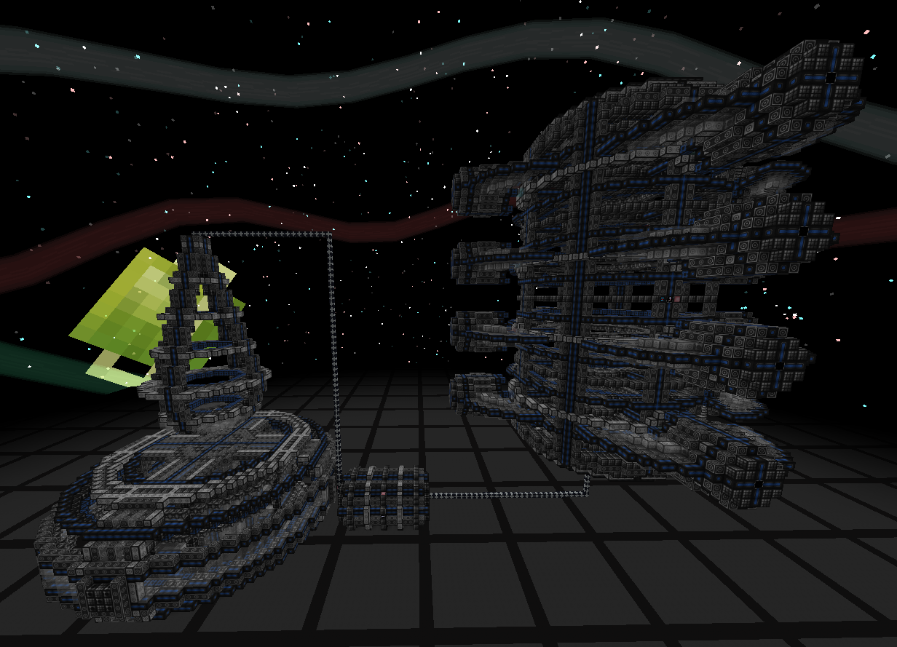

Start by building the BEC Multiblocks as pictured. The positioning is up to you, however the Entangler & Containment Field must be connected to the Maxwell Gate via the **left** BEC Hatch, and the Observation Arrays to the **right**. Build up to 16 Teleporters per Observation Array.

- The power given to the Entangler makes it entangle more fluids at once
- The power given to the Containment Field allows it to hold more fluid
- The power given to the Observation array caps the maximum number of
  parallels that can be done at once. You **must** give this enough power so that it is never an issue.

## 2. Setting up the automation

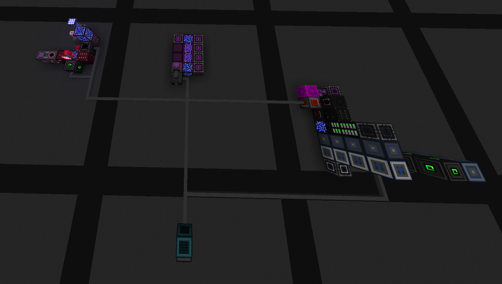

The non-OC automation side of this setup is mostly using AE2. We'll go through it step by step.

### The Pending Subnet (Black)

The pending subnet is where patterns are pushed directly by your Mainnet.
We put the pattern inputs here first so that we can maintain complete and
total pattern separation.

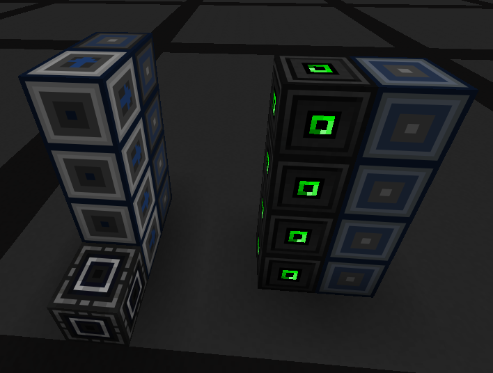

Set up some Dual Interfaces as seen above. These must be dual interfaces. White is your mainnet, and where your patterns will be placed. Wrench these so that they point into the Pending Subnet. Make sure to use Blocking Cards and Smart Blocking Mode.

Place additional Dual Interfaces with OpenComputer's Adapters next to them. You can place these using a Matter Manipulator so that the patterns are copied. These are not connected to any AE2 Network.

The idea is that the left interfaces will be the ones that actually push recipes, while the ones on the right have an <u>**unmultiplied copy of the pattern**</u>. This allows the script to determine the correct number of parallels. Remember to add to both whenever you make patterns.

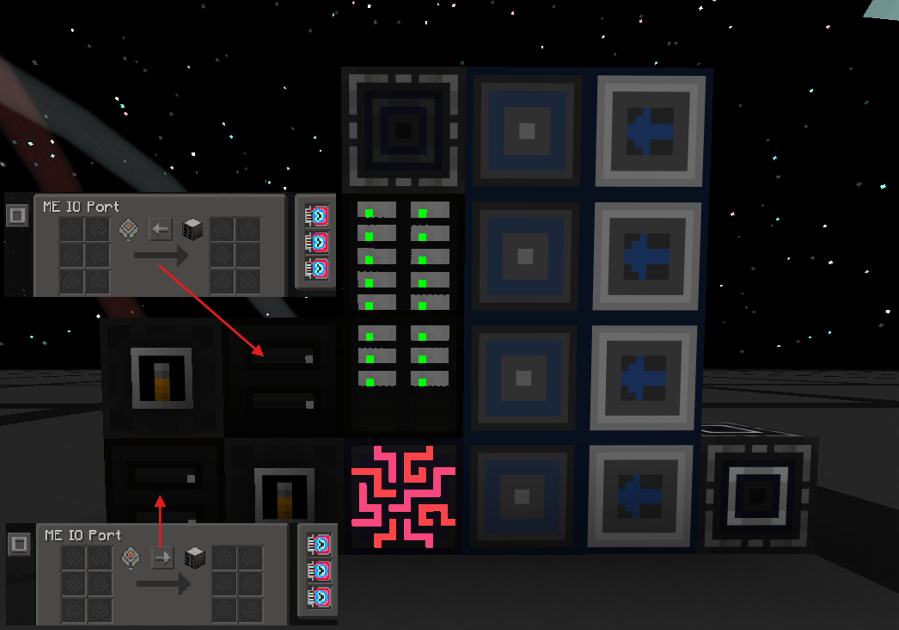

Add:
- 1 ME Controller
- 2 ME Drives (16x Item Digital Singularity)
- Wireless Connector (to Entangler)
- 2 IO Ports, with 3x Superluminal Acceleration Cards
- 2 Machine Hulls (w/ Machine Controller Cover)

Setup the IO Ports as shown. They are both on "Move to output when cell/network is empty".

The wireless connector should be linked to the Entangler.

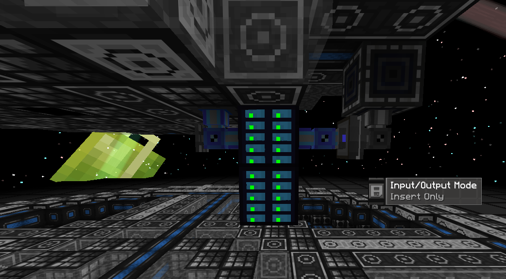

On the entangler, Connect the Pending Subnet Wireless Connector to a small subnet via an Insert Only Fluid Storage Bus. On the subnet add an Advanced Stocking Hatch and 2 ME Drives (20x Fluid Digital Singularity).


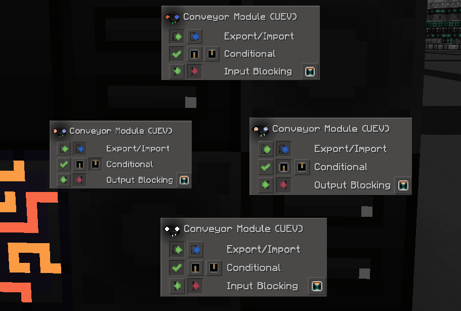

Back at the Pending Subnet, place 4 high-tier conveyors on the sides of the hulls facing the IO Ports. Change their settings to match what is pictured. Add a 16384k Item Drive to the top IO Port. For gate craft, switch this to an Artificial Universe item cell, as some recipes take more items than it can hold.

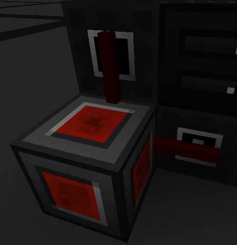

Add an OpenComputers Redstone I/O next to the hulls, connect it to the Controller Covers with red alloy wire.

### The Input Subnet (Magenta)

The Input Subnet is what provides the item inputs to each of the Teleporters.

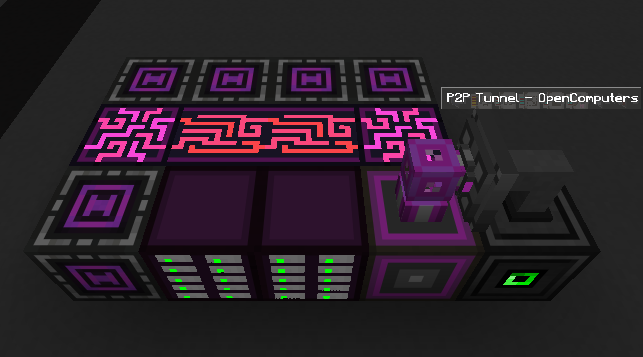

Start off by setting up the controller area like shown, including:
- 1 ME Interface, with an adjacent Adapter.
- 2 ME Drives (20x Item Digital Singularity) 
- Multiple Wireless Hubs
- An ME P2P connected directly to an OpenComputers cable.

It must be a normal (**not dual**) interface. The OC P2P will be how we route in connections to the multiblocks.

The single Wireless Hub next to the drives should be used to connect OC to the Maxwell Gate and Containment Field. You can do this with a simple Wireless Connector > OC P2P > Adapter. Repeat the below screenshot for both the Maxwell Gate and Containment Field.

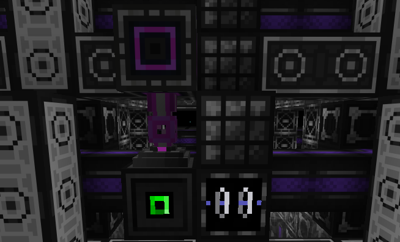

On the inside of each Teleporter, make a setup like below. The white Wireless Connector on the right should be hooked into your mainnet as the output. Do this however you'd like. The magenta Wireless Connector should be connected to the set of 4 Wireless Hubs on the Input Subnet. This connects to an Advanced Stocking Input Bus. Turn this on and reduce its refresh time. Connect the OC P2P like the Maxwell Gate/Containment Field. The red highlighted block is the controller, behind the adapter.

I highly recommend connecting each of the connectors evenly to the 4 Wireless Hubs on the controller. This is to make your life easier when MMing down the line to create additional Observation Arrays.

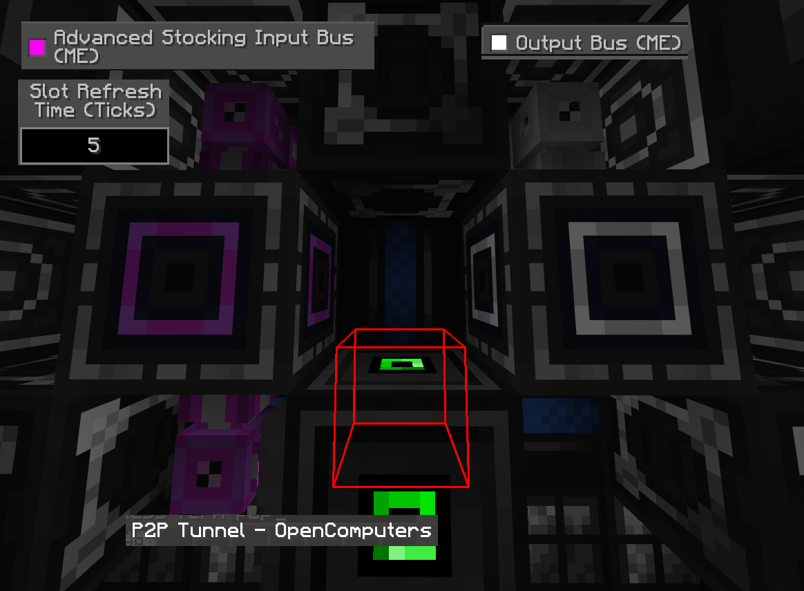

Also connect to the input subnet via the single hub the below setup on the IO Ports we placed earlier. Place a machine hull with a storage bus on it at high priority. Also place an Item Detector Cover on the machine hull facing into the Redstone I/O.

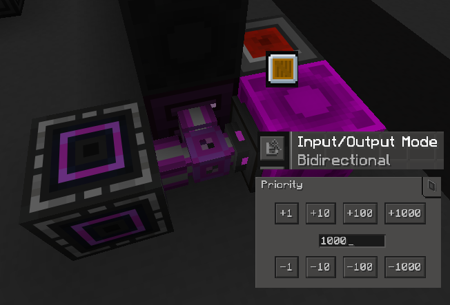

### The Nanite Subnet

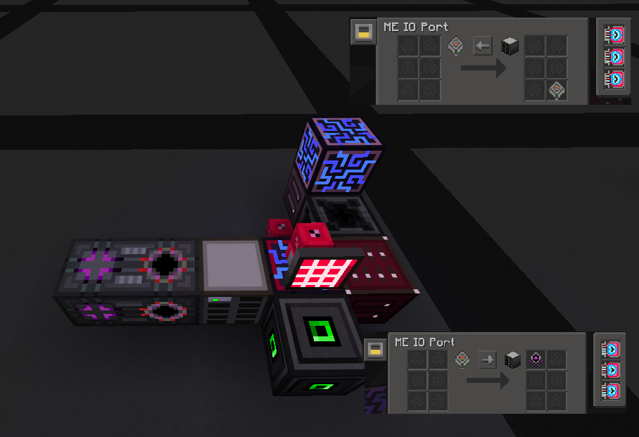

Set up a subnet like the below. AE2 coloring is important to prevent connections, so be sure to match the coloring. To start, include:
- 1 Neutronium ME Controller (w/ Adjacent Adapter)
- 2 IO Ports (3x Superluminal Acceleration Card)
- An OpenComputers Transposer between the two IO Ports
- 1 ME Drive (Item 16384k Cell, specifics below)
- 1 ME Crafting Storage and 1 ME Co-Processor

Note the random dummy ME Cell in the top IO Port. **This is important**, you can put 6 cells in at the same time to get it into that slot.

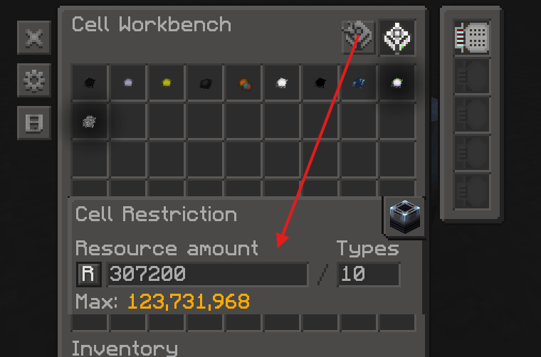

The Cell in the ME Drive should be partitioned as shown above. It should be:

- Filtered for each BEC Nanite
- Have an Equal Distribution Card
- Have the "Types" set to 10
- Have the "Resource Amount" set equal to 307,200 multiplied by the Number of Observation Arrays you have.

Once it is partitioned, you can put it in the ME Drive, and fill that subnet with your BEC Nanites. In the future, nanites can be added by just dumping them into this subnet.

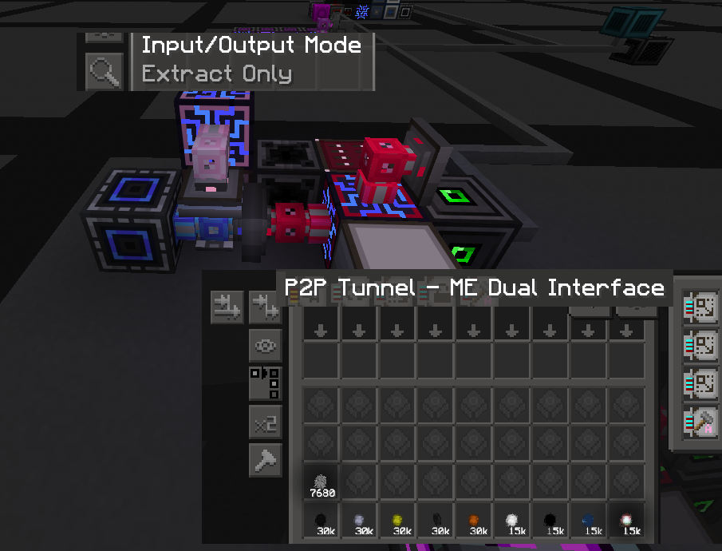

Set up the above additions to the Nanite Subnet.
- A Neutronium Energy Anchor
- A wireless connector, connected to a bidirectional storage bus on the Observation Array Nanite Containment Bus
- An Extract Only storage bus on the top, connected to the IO Port via the Pink controller.
- A P2P **Dual** Interface. This must be a P2P **Dual** Interface for future enhancements. Put this on Regular Blocking Mode, not smart blocking mode. Insert a Fake Crafting Card.

In the P2P Interface, we need to place 10 patterns. These will be created with both the input and output as the 10 BEC Nanites. The output should be renamed to the number of the tier, for example Carbon Nanites, the output should be renamed "1". The input should not be renamed.

**Important**: The patterns should be multiplied to be equal to: The number of nanites of that type that you have in the subnet divided by your number of Observation Arrays. So a single Observation Array with max nanites would have a pattern size of 30,720. Make sure to update the pattern size when you add more nanites!

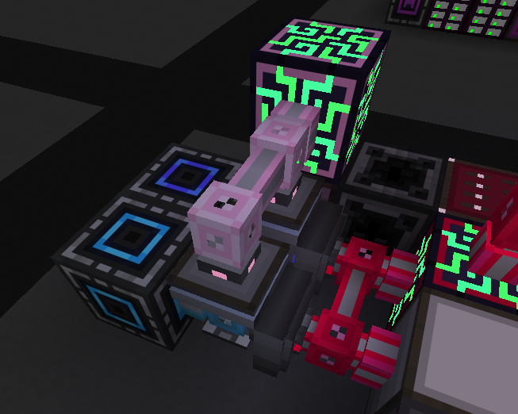

Whenever you decide to add more Observation Arrays with more Teleporters, you can simply duplicate the slice, and Memory Card the P2P Interface. Make sure to recolor the second slice so they don't connect.

## 3. OpenComputers Setup

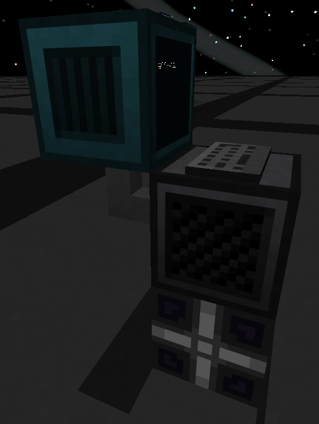
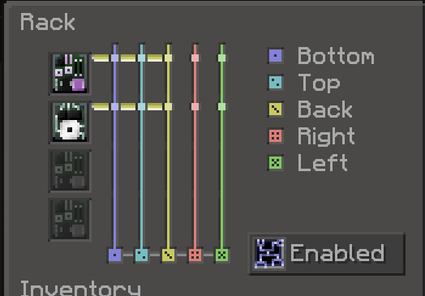

First, set up a Rack nearby with a Server (Tier 4) and a Disk Drive. Also
connect a Screen T3, Keyboard, and Neutronium Energy Cell.
- You can access the contents of a server/disk drive by right clicking it
  on the front face of the Rack.
- You have to use a Rack, you can't use a normal Computer.
- On the rack itself, set it up like in the screenshot. Make sure to connect the cable to the side of the rack that you indicate in the GUI.

Place an OpenOS floppy in the Disk Drive, and fill the Server with the
following components.
- 1x Graphics Card T3
- 1x CPU Tier 3
- 1x Magical Memory
- 1x Component Bus (Creative)
- 1x Hard Drive T3
- 1x EEPROM Lua Bios
- 1x Internet Card

Start the computer and install OpenOS. Once done, you can remove the disk
drive entirely.

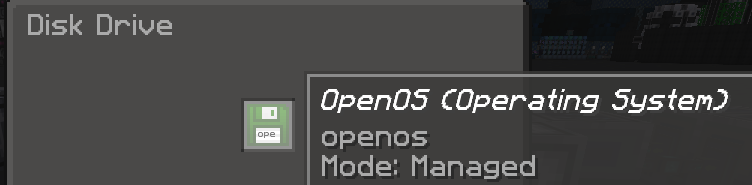
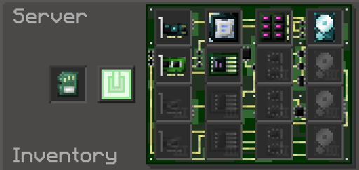

Now time to hook all the OC Components up. Run OC cable to each of the below.
- The adapter on the Nanite setup
- The transposer on the Nanite setup
- The adapter on the Magenta subnet
- The Redstone I/O
- The Dual Interfaces containing the unmultiplied patterns

## 4. Running the BEC Controller

On your OC Computer, do the following command (use middle mouse to
paste).

```
wget https://raw.githubusercontent.com/Armisael5/gtnh-bec-controller/main/bec_controller.lua /home/bec_controller.lua && bec_controller
```

This downloads the script and runs it. On that first run it registers
itself to start automatically on every future boot, so you won't need to
run it manually again. It also checks for a newer version on
every startup and updates itself automatically if one's available.

- Auto-run on startup can be disabled in config
- Auto-update can be disabled in config
- Discord Webhook integration can be setup in config.

You can use Ctrl+Alt+C to exit the script if needed while it's running.

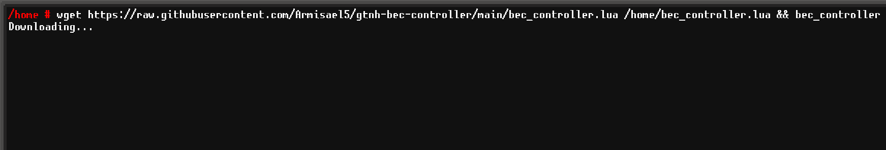

That's it!

## Passive Mode

Condensate is sent with the patterns. This automatically entangles the fluids, and after they are done, the recipe starts. However, entangler recipes are very long, so it is desirable to "passive" the creation of Condensate.

This can be done by simply "pre-loading" the Containment Field with a bunch of condensate of the types you need. It will have a buffer to start recipes instantly instead of waiting, and the buffer is automatically topped-up by the fluids included in the pattern.

To load fluids in, just put the desired amount in the subnet on the Entangler. Make sure to account for the Containment Strength you have set.


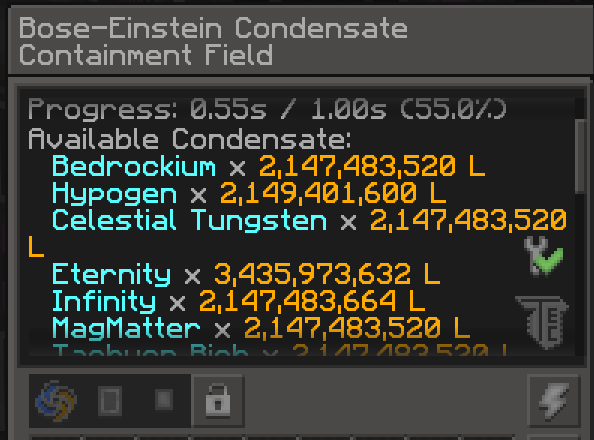

## Common issues & notes

- **"[UUID] never picked up work"**: Make sure each IONode properly
  forms (just being turned off is normal), and that the ASIB is properly
  connected for each.
- **"Input Subnet still has X items"**: Most likely a multiplied
  pattern on the adapter'd Dual Interfaces.

  There's a Tips & Tricks post for this setup in the GT:NH Discord, feel free to drop any questions or issues you're having in there.